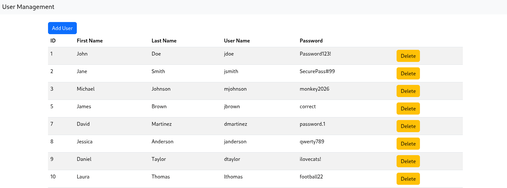

## Assignment 8: Add the Ability to Delete a User and Move the Add User Form to a Separate Page

This assignment builds on your Assignment 7, where you added a Database backend for Retrieving Users(SELECT) and Adding a User(INSERT). Ob this assignment, you will add the abulity to delete a user and move the add form to separate psge.

### Add the Ability to Delete a User Record
To add a secure delete capability with client-side confirmation to a traditional server-side rendered Node.js/Express application (using EJS or HTML forms), follow this sequential approach.



1. Create the Client-Side HTML Form and JS Confirmation:Avoid standard GET links to prevent accidental deletions from web crawlers or prefetching.In your view template (e.g., EJS), use an inline HTML form sending a POST request. Attach an onsubmit handler using standard Vanilla JS confirm() to prompt the user before sending the request.
```HTML
<!-- item-list.ejs -->
<ul>
  <% items.forEach(item => { %>
    <li>
      <span><%= item.name %></span>
      
      <!-- Delete Form -->
      <form 
        action="/items/<%= item.id %>/delete" 
        method="POST" 
        style="display:inline;"
        onsubmit="return confirm('Are you sure you want to delete item: <%= item.name %>?');"
      >
        <button type="submit" class="btn btn-danger">Delete</button>
      </form>
    </li>
  <% }); %>
</ul>
```
2. Define the Express Route Handler:Process the POST request and execute database operations securely.In your Express router or main app file, declare the route handler for /items/:id/delete. Extract the resource identifier from req.params.id, perform the deletion query, and redirect the client back to the updated list.

```JavaScript
// routes/items.js
const express = require('express');
const router = express.Router();
const db = require('../db'); // Your database interface/pool

router.post('/items/:id/delete', async (req, res, next) => {
  const itemId = req.params.id;

  try {
    // 1. Delete item from database (Example using SQL prepared statements)
    const result = await db.query('DELETE FROM items WHERE id = ?', [itemId]);

    // 2. Redirect client back to the main resource index
    res.redirect('/items');
  } catch (err) {
    // 3. Forward unexpected errors to Express error handling middleware
    next(err);
  }
});

module.exports = router;
```
